  

<h1 align="center">Sok0ru</h1>

 

  🌐 I build web applications and work on the servers behind them. 
  🌱 Learning by making, from the first interface to deployment.

 
<h3 data-importer="text" align="center">🛠️ My technology stack</h3>

 

  
  
  
  
  
  
  
  
  
  
  
  
  

 

  
  
  
  
  
  
  
  
  

 

<picture data-importer="pacman">
  <source media="(prefers-color-scheme: dark)" srcset="https://raw.githubusercontent.com/Sok0ru/Sok0ru/pacman-output/bomberman-contribution-graph-dark.svg?game=bomberman">
  <source media="(prefers-color-scheme: light)" srcset="https://raw.githubusercontent.com/Sok0ru/Sok0ru/pacman-output/bomberman-contribution-graph.svg?game=bomberman">
  
</picture>

 

  
  

 

  
  

 

  

 
