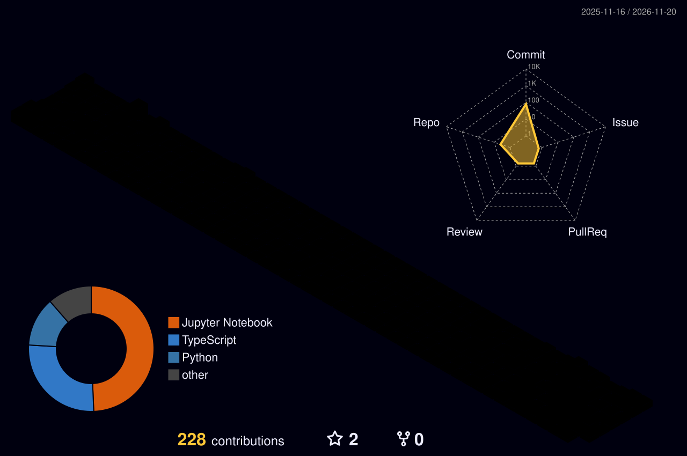

<h1 align="center">Sok0ru</h1>

  TypeScript, Vue и Python / Django. 
  Разработка веб-приложений и работа с серверами.

<h3 align="center">Языки и фреймворки</h3>

  

Также работаю с React и Bash

  

<h3 align="center">Сервисы и инструменты</h3>

  

Caddy · Termius для подключения к удалённым серверам

<h3 align="center">Рабочее окружение</h3>

  

<h3 align="center">Активность на GitHub</h3>

  

